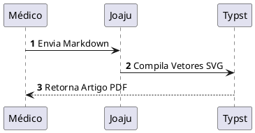

# Joaju Live Preview (`joaju-obsidian`)

Plugin oficial do [Obsidian](https://obsidian.md) para o ecossistema **Joaju**, fornecendo renderização instantânea (Live Preview e Reading View) para heredogramas clínicos, diagramas técnicos e cards tipográficos de links diretamente nas suas notas.

O **joaju-obsidian** fecha o elo de **paridade total (WYSIWYG)**: o mesmo diagrama vetorial que você visualiza enquanto digita na nota é o que será compilado no PDF final com tipografia acadêmica (Typst/ABNT/Vancouver).

---

## 🌟 Recursos

- **🧬 Heredogramas Clínicos (`pedtools`, `kinship2`):** Renderiza heredogramas genealógicos canônicos pelo padrão pedsuite em R (`pedtools`) ou padrão Bennett 2008 (`kinship2`).
- **🧪 Química Estrutural 2D (`openchemlib`, `openbabel`):** Visualização vetorial instantânea de moléculas químicas a partir de código SMILES ou arquivos `.mol`/`.smi`.
- **📊 Tabelas Acadêmicas (`table`):** Tabelas formatadas com réguas horizontais APA/ABNT a partir de dados tabulares ou arquivos `.csv`.
- **📐 D2 Declarativo (`d2`):** Diagramação moderna de fluxos, arquiteturas e tabelas SQL com layout de alta legibilidade.
- **🏗️ PlantUML & Graphviz (`plantuml`, `graphviz`, `mermaid`):** Diagramas formais de sequência, classes, estados, atividades e grafos de dependência.
- **📦 Empacotamento de Workspace (ZIP):** Ao compilar a nota para PDF, o plugin cria um pacote ZIP em memória contendo a nota e todos os anexos locais (imagens, CSVs, MOLs), resolvendo wikilinks do Obsidian (`![[foto.png]]`, `![[imagem.png|400]]`), normalizando nomes com caracteres especiais (`_`) e prevenindo colisões de nomes idênticos entre pastas distintas com desambiguação automática.
- **📇 Cards Tipográficos de Links:** Links isolados na linha são automaticamente expandidos em cards ricos com título, imagem de capa, snippet, domínio e tempo de leitura — sem Chromium, usando Readability no backend.
- **📄 Compilação Nativa de Artigos (PDF):** Envia a nota Markdown atual para compilação no Joaju e salva o PDF resultante diretamente na mesma pasta da nota.
- **🦊 Integração com Fuxico (Pastebin):**
  - **Compilar & Fuxicar PDF:** Compila o PDF e faz upload imediato para sua instância Fuxico, adicionando o link (`fuxico_pdf`) e a tag `fuxico` ao frontmatter, com a URL copiada para a área de transferência.
  - **Fuxicar Markdown:** Publica o arquivo Markdown bruto no Fuxico, registrando `fuxico_md` e tag `fuxico` no frontmatter.
- **🐾 Sincronização Bibliográfica Nativa (Tatupeba):** Gatilho em 1 clique para extrair referências, anotações de leitura em PDFs e o arquivo BibTeX do Zotero via daemon conteinerizado.
- **⚡ Cache em Memória LRU:** Re-renderização a 0ms ao rolar ou alternar notas.
- **⏳ Debounce Configurável:** Digite suavemente sem travar o editor nem sobrecarregar o servidor.
- **🛡️ Tratamento Gracioso de Erros:** Avisos discretos inline caso haja erro de sintaxe, sem quebrar o layout da nota.
- **🔒 Soberania de Dados:** Conecta diretamente aos seus servidores locais/VPN (Joaju, Tatupeba e Fuxico).

---

## 🚀 Instalação no Obsidian

Clone o repositório diretamente na pasta de plugins do seu vault do Obsidian:

```bash
Crie a pasta do plugin dentro do seu vault e baixe apenas os 3 arquivos distribuíveis (`main.js`, `manifest.json`, `styles.css`), sem poluir seu vault com `.git` ou dependências de desenvolvimento:

```bash
mkdir -p <caminho-do-seu-vault>/.obsidian/plugins/joaju-obsidian
# Se estiver no repositório de desenvolvimento:
npm run deploy
```

1. Abra o Obsidian e vá em **Configurações > Opções da Comunidade (Community Plugins)**.
2. Clique no ícone de recarregar plugins instalados.
3. Ative o plugin **Joaju Live Preview**.

---

## ⚙️ Configurações

Acesse **Configurações > Joaju Live Preview**:

* **Servidor Joaju (URL):** Endereço da API Joaju (padrão: `http://localhost:3000`).
* **Servidor Tatupeba (URL):** Endereço do daemon Tatupeba para sincronização de referências Zotero (padrão: `http://localhost:3001`).
* **Token de Autenticação Tatupeba:** Chave de segurança para sincronização via webhook (Bearer / X-Api-Key).
* **Debounce (ms):** Tempo de espera (padrão: `400ms`) antes de renderizar diagramas.
* **Servidor Fuxico (URL):** Instância Fuxico para publicação (padrão: `http://localhost:8080`).
* **Token de Autenticação Fuxico:** Chave de API Bearer para envio de arquivos.
* **Repositório Codeberg:** Repositório canônico (`lumenpink/joaju-obsidian`).
* **Branch / Canal:** Branch de busca (`main`).
* **Verificar atualizações ao iniciar:** Checagem autônoma em segundo plano ao abrir o Obsidian.
* **Botão "Verificar agora":** Consulta o Codeberg e atualiza o plugin diretamente pela UI do Obsidian em 1 clique (com hot-reload imediato).
* **📇 Habilitar Cards de Links:** Ativa a expansão automática de links isolados em cards tipográficos (padrão: ativado).
* **Pasta de Anexos para Cards:** Caminho relativo ao vault onde imagens de capa e snapshots PDF são salvos (padrão: `_attachments/cards`).

---

## ⌨️ Comandos Disponíveis

Pela paleta de comandos (`Ctrl+P` / `Cmd+P`) ou ícone da barra lateral (ribbon):

1. **Joaju: Compilar nota atual para PDF**
2. **Joaju: Compilar e publicar PDF no Fuxico**
3. **Joaju: Publicar Markdown no Fuxico**
4. **Joaju: Sincronizar Zotero (Tatupeba)**
5. **Joaju: Verificar atualizações no Codeberg**
6. **Joaju: Preencher título do link na linha atual (!title / !url)** — busca o título real da URL e converte `!https://url` ou `[!title](url)` em `[Título](url)` na linha do cursor.
7. **Joaju: Recarregar todos os cards desta nota** — limpa o cache dos links isolados da nota ativa; ao reabrir em modo Leitura os cards são re-buscados.

---

## ✍️ Exemplos de Uso

### 1. Cards Tipográficos de Links

**Atalho direto e preenchimento automático** — escreva a URL com `!` na frente, em uma linha isolada:

```markdown
!https://example.com/artigo-legal
```

Ao pressionar `Enter` ou mudar de linha, o plugin consulta o Joaju em segundo plano e converte a linha no arquivo Markdown automaticamente para:

```markdown
[Título Real do Artigo](https://example.com/artigo-legal)
```

No **Live Preview (modo edição)**, assim que o cursor sai da linha, o link isolado se transforma imediatamente em um **Card Tipográfico rico**. Se você mover o cursor para a linha ou clicar no botão `✏️`, o card se recolhe mostrando o Markdown puro para edição.

Também suporta a sintaxe explícita com preenchimento automático ao sair da linha:

```markdown
[!title](https://example.com/artigo-legal)
```

**Suprimir card individual** — adicione `<!-- nocard -->` na mesma linha:

```markdown
[Link que não vira card](https://example.com) <!-- nocard -->
```

**Desabilitar cards em uma nota inteira** — no frontmatter:

```yaml
---
cards: false
---
```

### 2. Heredograma Clínico Canônico (`pedtools`)

````markdown
```pedtools
%% layout.width=85%
%% title="Linhagem Familiar - Fibrose Cística"
id,   fid,  mid,  sex, aff
I:1,    0,    0,    1,   1
I:2,    0,    0,    2,   1
II:1, I:1,  I:2,    1,   2
II:2, I:1,  I:2,    2,   1
```
````

Ou referenciando um arquivo CSV anexo:

````markdown
```pedtools
%% src=attachments/familia.csv
%% layout.width=80%
```
````

### 3. Química Estrutural 2D (`openchemlib` e `openbabel`)

````markdown
```openchemlib
%% title="Molécula de Paracetamol"
CC(=O)Nc1ccc(O)cc1
```
````

### 4. Tabelas Acadêmicas (`table`)

````markdown
```table
%% caption="Comparativo dos Parâmetros Clínicos"
%% src=attachments/dados_clinicos.csv
```
````

### 5. Fluxograma Moderno (`d2`)

````markdown
```d2
%% width=75%
coleta: Coleta de Sangue -> sequenciamento: Sequenciamento NGS
sequenciamento -> analise: Análise Bioinformática
analise -> laudo: Laudo Médico
```
````

### 6. Diagrama de Sequência (`plantuml`)

````markdown

````

### 7. Publicação Web no Fuxico (Shortlinks e Assets)

Ao executar o comando **Joaju: Publicar Markdown no Fuxico**:
- **Persistência de Shortlink:** O plugin armazena `fuxico_md: https://2lp.in/<slug>` no frontmatter da nota. Em republicações subsequentes da mesma nota, o shortlink existente é reutilizado e o documento é sobrescrito no mesmo endereço.
- **Upload Automático de Assets:** Todas as imagens locais referenciadas no corpo da nota (via wikilinks `![[imagem.png]]` ou sintaxe padrão ``) são detectadas, desambiguadas e enviadas como anexos binários, sendo servidas na página sob `/<slug>/assets/<filename>`.

---

## 📋 Conformidade GOST

Este projeto adota a norma **[GOST](https://codeberg.org/lumenpink/gost)** (Gosplan Standard for Technical Software).

- **Versão GOST:** `1.1.0`
- **Perfil:** `profiles/lumen.md`
- **Linguagens declaradas:** `javascript`
- **Licença:** `Apache-2.0`

---

## 📄 Licença

Distribuído sob a licença [Apache-2.0](./LICENSE).
