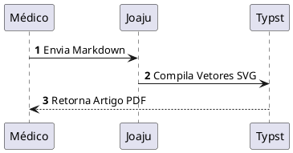

# Joaju Live Preview (`joaju-obsidian`)

Plugin oficial do [Obsidian](https://obsidian.md) para o ecossistema **Joaju**, fornecendo renderização instantânea (Live Preview e Reading View) para heredogramas clínicos e diagramas técnicos diretamente nas suas notas.

O **joaju-obsidian** fecha o elo de **paridade total (WYSIWYG)**: o mesmo diagrama vetorial que você visualiza enquanto digita na nota é o que será compilado no PDF final com tipografia acadêmica (Typst/ABNT/Vancouver).

---

## 🌟 Recursos

- **🧬 Kinship Clínico (`kinship`, `kinship2`, `heredograma`, `pedigree`):** Renderiza heredogramas genealógicos completos segundo o padrão Bennett 2008 (`kinship2` em R).
- **📐 D2 Declarativo (`d2`):** Diagramação moderna de fluxos, arquiteturas e tabelas SQL com layout de alta legibilidade.
- **🏗️ PlantUML (`plantuml`, `puml`):** Diagramas formais de sequência, classes, estados, atividades e cronogramas.
- **⚡ Cache em Memória LRU:** Re-renderização a 0ms ao rolar ou alternar notas.
- **⏳ Debounce Configurável:** Digite suavemente sem travar o editor nem sobrecarregar o servidor.
- **🛡️ Tratamento Gracioso de Erros:** Avisos discretos inline caso haja erro de sintaxe, sem quebrar o layout da nota.
- **🔒 Soberania de Dados:** Conecta diretamente ao seu servidor Joaju (`https://joaju.lumen.pink` ou `http://localhost:3000`).

---

## 🚀 Instalação no Obsidian

Clone o repositório diretamente na pasta de plugins do seu vault do Obsidian:

```bash
cd <caminho-do-seu-vault>/.obsidian/plugins
git clone https://codeberg.org/lumenpink/joaju-obsidian.git
```

1. Abra o Obsidian e vá em **Configurações > Opções da Comunidade (Community Plugins)**.
2. Clique no ícone de recarregar plugins instalados.
3. Ative o plugin **Joaju Live Preview**.

---

## ⚙️ Configurações

Acesse **Configurações > Joaju Live Preview**:

* **Servidor Joaju (URL):** Endereço da API Joaju (padrão: `https://joaju.lumen.pink`). Para desenvolvimento offline local, configure para `http://localhost:3000`.
* **Debounce (ms):** Tempo de espera (padrão: `400ms`) após a última tecla digitada antes de disparar a compilação do diagrama.

---

## ✍️ Exemplos de Uso

### 1. Heredograma Clínico (`kinship`)

````markdown
```kinship
%% layout.width=80%
id, pai, mae, sexo, fenotipo, falecido, probando, idade, label
I:1,  0,   0,    M, portador,        0,        0,   68a, Avô
I:2,  0,   0,    F, portador,        0,        0,   65a, Avó
II:1, I:1, I:2,  F,  afetado,        0,        1,   38a, Caso [P]
II:2, I:1, I:2,  M,   higido,        0,        0,   35a, Irmão
```
````

### 2. Fluxograma Moderno (`d2`)

````markdown
```d2
%% width=75%
coleta: Coleta de Sangue -> sequenciamento: Sequenciamento NGS
sequenciamento -> analise: Análise Bioinformática
analise -> laudo: Laudo Médico
```
````

### 3. Diagrama de Sequência (`plantuml`)

````markdown

````

---

## 📋 Conformidade GOST

Este projeto adota a norma **[GOST](https://codeberg.org/lumenpink/gost)** (Gosplan Standard for Technical Software).

- **Versão GOST:** `1.1.0`
- **Perfil:** `profiles/lumen.md`
- **Linguagens declaradas:** `javascript`
- **Licença:** `Apache-2.0`

---

## 📄 Licença

Distribuído sob a licença [Apache-2.0](./LICENSE).
