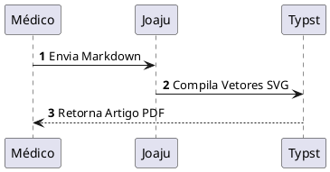

# Joaju Live Preview (`joaju-obsidian`)

Plugin oficial do [Obsidian](https://obsidian.md) para o ecossistema **Joaju**, fornecendo renderização instantânea (Live Preview e Reading View) para heredogramas clínicos e diagramas técnicos diretamente nas suas notas.

O **joaju-obsidian** fecha o elo de **paridade total (WYSIWYG)**: o mesmo diagrama vetorial que você visualiza enquanto digita na nota é o que será compilado no PDF final com tipografia acadêmica (Typst/ABNT/Vancouver).

---

## 🌟 Recursos

- **🧬 Kinship Clínico (`kinship`, `kinship2`, `heredograma`, `pedigree`):** Renderiza heredogramas genealógicos completos segundo o padrão Bennett 2008 (`kinship2` em R).
- **📐 D2 Declarativo (`d2`):** Diagramação moderna de fluxos, arquiteturas e tabelas SQL com layout de alta legibilidade.
- **🏗️ PlantUML (`plantuml`, `puml`):** Diagramas formais de sequência, classes, estados, atividades e cronogramas.
- **📄 Compilação Nativa de Artigos (PDF):** Envia a nota Markdown atual para compilação no Joaju e salva o PDF resultante diretamente na mesma pasta da nota.
- **🦊 Integração com Fuxico (Pastebin):**
  - **Compilar & Fuxicar PDF:** Compila o PDF e faz upload imediato para o Fuxico (`https://2lp.in`), adicionando o link (`fuxico_pdf`) e a tag `fuxico` ao frontmatter, com a URL copiada para a área de transferência.
  - **Fuxicar Markdown:** Publica o arquivo Markdown bruto no Fuxico, registrando `fuxico_md` e tag `fuxico` no frontmatter.
- **⚡ Cache em Memória LRU:** Re-renderização a 0ms ao rolar ou alternar notas.
- **⏳ Debounce Configurável:** Digite suavemente sem travar o editor nem sobrecarregar o servidor.
- **🛡️ Tratamento Gracioso de Erros:** Avisos discretos inline caso haja erro de sintaxe, sem quebrar o layout da nota.
- **🔒 Soberania de Dados:** Conecta diretamente aos seus servidores Joaju e Fuxico.

---

## 🚀 Instalação no Obsidian

Clone o repositório diretamente na pasta de plugins do seu vault do Obsidian:

```bash
Crie a pasta do plugin dentro do seu vault e baixe apenas os 3 arquivos distribuíveis (`main.js`, `manifest.json`, `styles.css`), sem poluir seu vault com `.git` ou dependências de desenvolvimento:

```bash
mkdir -p <caminho-do-seu-vault>/.obsidian/plugins/joaju-obsidian
# Se estiver no repositório de desenvolvimento:
npm run deploy
```

1. Abra o Obsidian e vá em **Configurações > Opções da Comunidade (Community Plugins)**.
2. Clique no ícone de recarregar plugins instalados.
3. Ative o plugin **Joaju Live Preview**.

---

## ⚙️ Configurações

Acesse **Configurações > Joaju Live Preview**:

* **Servidor Joaju (URL):** Endereço da API Joaju (padrão: `http://baquara:3000`).
* **Debounce (ms):** Tempo de espera (padrão: `400ms`) antes de renderizar diagramas.
* **Servidor Fuxico (URL):** Instância Fuxico para publicação (padrão: `https://2lp.in`).
* **Token de Autenticação Fuxico:** Chave de API Bearer para envio de arquivos.
* **Repositório Codeberg:** Repositório canônico (`lumenpink/joaju-obsidian`).
* **Branch / Canal:** Branch de busca (`main`).
* **Verificar atualizações ao iniciar:** Checagem autônoma em segundo plano ao abrir o Obsidian.
* **Botão "Verificar agora":** Consulta o Codeberg e atualiza o plugin diretamente pela UI do Obsidian em 1 clique (com hot-reload imediato).

---

## ⌨️ Comandos Disponíveis

Pela paleta de comandos (`Ctrl+P` / `Cmd+P`) ou ícone da barra lateral (ribbon):

1. **Joaju: Compilar nota atual para PDF**
2. **Joaju: Compilar e publicar PDF no Fuxico**
3. **Joaju: Publicar Markdown no Fuxico**
4. **Joaju: Verificar atualizações no Codeberg**

---

## ✍️ Exemplos de Uso

### 1. Heredograma Clínico (`kinship`)

````markdown
```kinship
%% layout.width=80%
id, pai, mae, sexo, fenotipo, falecido, probando, idade, label
I:1,  0,   0,    M, portador,        0,        0,   68a, Avô
I:2,  0,   0,    F, portador,        0,        0,   65a, Avó
II:1, I:1, I:2,  F,  afetado,        0,        1,   38a, Caso [P]
II:2, I:1, I:2,  M,   higido,        0,        0,   35a, Irmão
```
````

### 2. Fluxograma Moderno (`d2`)

````markdown
```d2
%% width=75%
coleta: Coleta de Sangue -> sequenciamento: Sequenciamento NGS
sequenciamento -> analise: Análise Bioinformática
analise -> laudo: Laudo Médico
```
````

### 3. Diagrama de Sequência (`plantuml`)

````markdown

````

---

## 📋 Conformidade GOST

Este projeto adota a norma **[GOST](https://codeberg.org/lumenpink/gost)** (Gosplan Standard for Technical Software).

- **Versão GOST:** `1.1.0`
- **Perfil:** `profiles/lumen.md`
- **Linguagens declaradas:** `javascript`
- **Licença:** `Apache-2.0`

---

## 📄 Licença

Distribuído sob a licença [Apache-2.0](./LICENSE).
